::: {align="center"}
``{=html}

``{=html}

`<a href="https://github.com/Vishal34sd">`{=html}
``{=html}
`</a>`{=html}

`<br/>`{=html}

`<a href="https://linkedin.com/in/dubey-vishal01">`{=html}``{=html}`</a>`{=html}
`<a href="mailto:dubeyvishal714@gmail.com">`{=html}``{=html}`</a>`{=html}
`<a href="https://github.com/Vishal34sd">`{=html}``{=html}`</a>`{=html}
`<a href="https://leetcode.com/u/vishal-dubey07">`{=html}``{=html}`</a>`{=html}
`<a href="#">`{=html}``{=html}`</a>`{=html}
:::

``{=html}

## 👋 About Me

::: {align="center"}
``{=html}

``{=html}
:::

``` yaml
name: Vishal Dubey
role: Full Stack Developer (MERN)
education: B.Tech, Computer Science & Engineering
current_focus: Building scalable full-stack apps & contributing to open source
recent_experience: Full Stack Developer Intern @ Iconsteam Global Infrastructure
```

-   🎓 B.Tech CSE student passionate about **Web Development** and
    **Open Source**
-   💼 Completed a **Full Stack Developer Internship** at **Iconsteam
    Global Infrastructure** (May 2026 -- Aug 2026), contributing to
    full-stack web development projects
-   💻 Building and shipping projects using the **MERN stack** (MongoDB,
    Express.js, React, Node.js)
-   🌱 Currently sharpening skills in **Next.js**, **TailwindCSS**, and
    cloud deployment (**AWS / Azure**)
-   ⚡ Fun fact: I enjoy turning messy ideas into clean, working
    products

::: {align="center"}

:::

``{=html}

## 💼 Experience

```{=html}

## 💼 Experience

<table>
<tr>
<td width="120" align="center">
  
</td>
<td>

**Full Stack Developer Intern** — Iconsteam Global Infrastructure

*May 2026 – Aug 2026 (3 months)*

Contributed to full-stack web development projects across the MERN stack, collaborating on features end-to-end from database design to UI implementation.

</td>
</tr>
</table>

```
``{=html}

## 🛠️ Tech Stack

::: {align="center"}


**Frontend** `<br/>`{=html}
``{=html}
``{=html}
``{=html}
``{=html}
``{=html}
``{=html}
``{=html}

**Backend** `<br/>`{=html}
``{=html}
``{=html}

**Databases** `<br/>`{=html}
``{=html}
``{=html}
``{=html}

**Tools & Platforms** `<br/>`{=html}
``{=html}
``{=html}
``{=html}
``{=html}
``{=html}

**Languages & Data** `<br/>`{=html}
``{=html}
``{=html}
``{=html}
``{=html}
``{=html}
:::

``{=html}

## 🚀 Featured Projects

::: {align="center"}
`<a href="https://github.com/Vishal34sd/Smart-CLI-Based-Agent">`{=html}
``{=html}
`</a>`{=html} `<a href="https://github.com/Vishal34sd/Expense-tracker_repo">`{=html}
``{=html}
`</a>`{=html}
:::

> Replace `Smart-CLI-Based-Agent` / `Expense-tracker_repo` with your actual repo
> names to pin your best work here.

``{=html}

## 📊 GitHub Stats

::: {align="center"}
``{=html}
``{=html}

``{=html}
:::

### 🏆 Trophies

::: {align="center"}
``{=html}
:::

### 🟩 Contribution Graph

::: {align="center"}
``{=html}

`<br/>`{=html}`<br/>`{=html}

``{=html}

`<br/>`{=html}`<br/>`{=html}

`<picture>`{=html}
`<source media="(prefers-color-scheme: dark)" srcset="https://raw.githubusercontent.com/Vishal34sd/Vishal34sd/output/github-snake-dark.svg"/>`{=html}
``{=html}
`</picture>`{=html}
:::

> 💡 For an even more eye-catching **animated** green-on-black
> contribution snake, add the
> [Platane/snk](https://github.com/Platane/snk) GitHub Action to your
> profile repo --- it generates a snake that "eats" your contribution
> squares and updates automatically on every push.

``{=html}

## 🤝 Let's Connect

::: {align="center"}
``{=html}

I'm always open to collaborating on interesting full-stack / open-source
projects --- feel free to reach out!

`<a href="https://linkedin.com/in/dubey-vishal01">`{=html}``{=html}`</a>`{=html}
`<a href="mailto:dubeyvishal714@gmail.com">`{=html}``{=html}`</a>`{=html}
`<a href="https://twitter.com/your-handle">`{=html}``{=html}`</a>`{=html}
:::

``{=html}

::: {align="center"}
``{=html}
:::

``{=html}

```{=html}
<!-- Proudly upgraded with ❤️ -->
```
