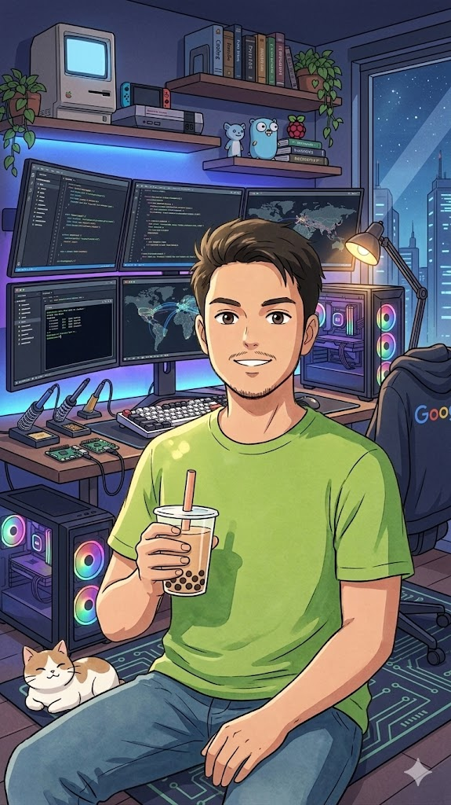

<div align="center">



<a href="https://git.io/typing-svg"></a>

<br/>

<a href="https://linkedin.com/in/dubey-vishal01"></a>
<a href="mailto:dubeyvishal714@gmail.com"></a>
<a href="https://github.com/Vishal34sd"></a>
<a href="https://leetcode.com/vishal-dubey07"></a>
<a href="#"></a>

</div>


## 👋 About Me

<table>
<tr>
<td width="220" align="center" valign="top">

</td>
<td valign="top">

```yaml
role:      Full Stack Developer
focus:     MERN · npm CLIs · AI-powered features
college:   KIET · CSE 2028
open_to:   Internships · Open Source · Collaboration
```

- 🔭 Building full-stack products and developer tools
- 🌱 Mentoring in open source (GSSoC 2026) and coordinating at Innogeeks
- 🧩 Solving problems on LeetCode (250+ solved)
- ⚡ Ask me about MERN, CLIs, and AWS

</td>
</tr>
</table>

<div align="center">


</div>


## 💼 Experience

<table>
<tr>
<td width="90" align="center"></td>
<td>

**Full Stack Developer Intern** · Iconsteam Global Infrastructure
<br/>📅 May 2026 – Aug 2026

</td>
</tr>
</table>


## 🛠️ Tech Stack

<div align="center">

</div>


## 🚀 Featured Projects

<div align="center">

<a href="https://github.com/Vishal34sd/Smart-CLI-Based-Agent"></a>
<a href="https://github.com/Vishal34sd/Expense-tracker_repo"></a>

</div>


## 📊 GitHub Stats

<div align="center">


### 🏆 Trophies


### 🟩 Contribution Graph


<picture>
  <source media="(prefers-color-scheme: dark)" srcset="https://raw.githubusercontent.com/Vishal34sd/Vishal34sd/output/github-snake-dark.svg">
  <source media="(prefers-color-scheme: light)" srcset="https://raw.githubusercontent.com/Vishal34sd/Vishal34sd/output/github-snake.svg">
  
</picture>

<sub>💡 The snake needs the [Platane/snk](https://github.com/Platane/snk) GitHub Action to generate the `output` branch.</sub>

</div>


## 🤝 Let's Connect

<div align="center">


<a href="https://twitter.com/your-handle"></a>
</div>

<div align="center">


</div>

<!-- Proudly upgraded with ❤️ -->
